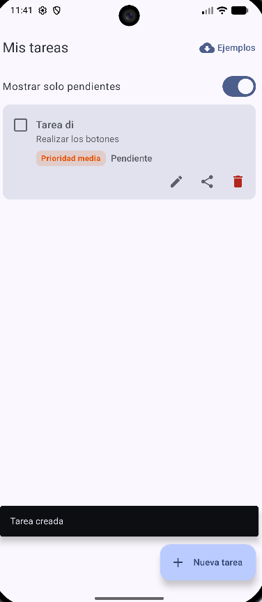
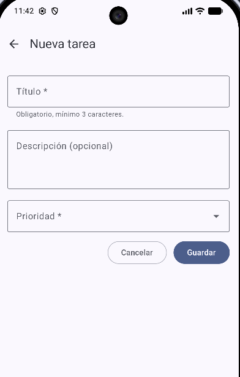
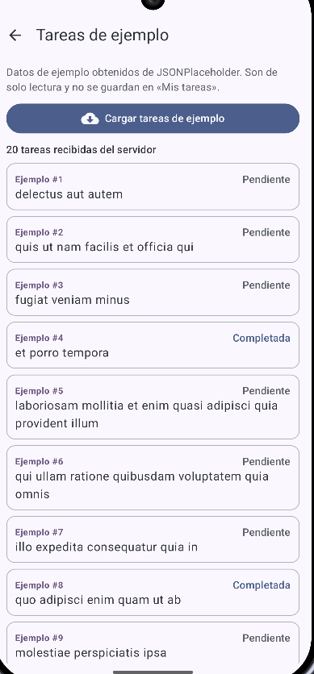
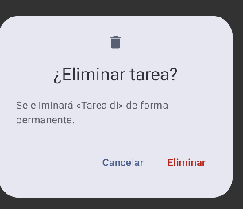
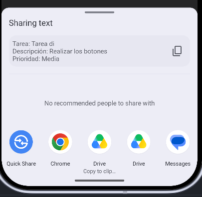
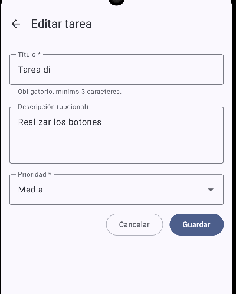

# Gestor Personal de Tareas

Aplicación Android desarrollada para la práctica de **PMDM (Programación Multimedia y Dispositivos Móviles)**.
Permite registrar tareas personales, consultarlas, modificarlas, marcarlas como completadas y eliminarlas.
Las tareas se guardan de forma permanente con **Room**, la preferencia de filtrado con **DataStore**,
se consultan tareas de ejemplo de un servicio web REST con **Retrofit** y se pueden compartir con otras
aplicaciones mediante un **Intent implícito**.

- Lenguaje: Kotlin
- Interfaz: Jetpack Compose + Material 3
- Una única `MainActivity` con navegación sencilla basada en estados (sin librería de navegación)

## Funcionalidades

| Funcionalidad | Cómo está implementada |
| --- | --- |
| Listado de tareas | `LazyColumn` con título, descripción, prioridad (etiqueta de color) y estado (Pendiente/Completada). Mensaje informativo con icono cuando no hay tareas. |
| Crear tarea | Formulario con título, descripción, prioridad (menú desplegable `ExposedDropdownMenuBox`), botón **Guardar** y botón **Cancelar**. |
| Validaciones | Título obligatorio, no solo espacios y con al menos 3 caracteres tras `trim()`; prioridad obligatoria y una de las tres (BAJA, MEDIA, ALTA); descripción opcional. Los errores aparecen debajo del campo correspondiente. |
| Evitar duplicados | El botón Guardar se deshabilita mientras se guarda y el ViewModel ignora nuevas peticiones si ya hay un guardado en curso. |
| Editar tarea | El mismo formulario se abre con los datos actuales leídos de Room; se conserva el estado completada/pendiente. |
| Completar | `Checkbox` en cada tarea; el cambio se guarda en Room. |
| Eliminar | `AlertDialog` de confirmación; si se cancela, la tarea no cambia. |
| Persistencia | Room (entidad, DAO, base de datos y repositorio). Las tareas se recuperan al volver a abrir la app. |
| Filtro | `Switch` «Mostrar solo pendientes» guardado con Preferences DataStore (valor inicial: mostrar todas). |
| Tareas de ejemplo | Retrofit + Gson contra `GET https://jsonplaceholder.typicode.com/todos?userId=1`. Botón de carga (deshabilitado mientras carga), indicador de progreso, resultados con id, título y estado, mensaje de error sin conexión y botón **Reintentar**. No se guardan en Room. |
| Compartir | Botón de compartir en cada tarea: `Intent.ACTION_SEND` (`text/plain`) con título, descripción y prioridad, abierto con `Intent.createChooser`. Si no hay ninguna app compatible se muestra un aviso; nunca se muestra un mensaje de «enviado». |
| Adaptación a pantallas | Con menos de 600 dp de ancho: una columna, y las tareas de ejemplo en su propia pantalla (botón «Ejemplos»). Con 600 dp o más: dos columnas (Mis tareas / Tareas de ejemplo). El formulario limita su ancho a 600 dp. |
| Estados de interfaz | Cargando, lista vacía, datos disponibles, operación en curso, completada y error (`EstadoListaTareas`, `EstadoOperacion`, `EstadoTareasEjemplo`). |

## Organización del proyecto

```
app/src/main/java/com/example/gestorpersonaldetareas/
├── MainActivity.kt                  Única Activity; carga AppGestorTareas()
├── modelo/                          Clases que representan las tareas
│   ├── Tarea.kt                     Tarea usada por la interfaz
│   ├── Prioridad.kt                 enum BAJA, MEDIA, ALTA
│   └── ValidadorTarea.kt            Reglas de validación del formulario
├── almacenamiento/                  Room
│   ├── TareaEntity.kt               Entidad (tabla "tareas") y conversión a/desde Tarea
│   ├── TareaDao.kt                  Consultar, insertar, actualizar y eliminar
│   ├── TareasDatabase.kt            Base de datos (singleton)
│   └── TareasRepositorio.kt         Puente entre Room y la interfaz
├── preferencias/                    DataStore
│   └── PreferenciasRepositorio.kt   Lectura/escritura de «Mostrar solo pendientes»
├── comunicaciones/                  Retrofit
│   ├── TareaRemota.kt               Modelo de la respuesta JSON
│   ├── JsonPlaceholderApi.kt        Interfaz con GET /todos
│   └── ClienteRetrofit.kt           Configuración de Retrofit + Gson
└── interfaz/                        Compose
    ├── AppGestorTareas.kt           Navegación por estados y adaptación de pantalla
    ├── PantallaListaTareas.kt       Pantalla principal, tarjetas, filtro y diálogo de borrado
    ├── PantallaFormularioTarea.kt   Formulario de crear/editar
    ├── PantallaTareasEjemplo.kt     Apartado «Tareas de ejemplo»
    ├── CompartirTarea.kt            Intent ACTION_SEND
    ├── EstadosUi.kt                 Estados de la interfaz (sealed interfaces)
    ├── TareasViewModel.kt           Lógica de las tareas personales (Room + DataStore)
    ├── TareasEjemploViewModel.kt    Lógica de la consulta a la API
    └── tema/                        Colores, tipografía y tema Material 3
```

Recursos gráficos locales: iconos vectoriales en `app/src/main/res/drawable/` (`ic_anadir`, `ic_editar`,
`ic_eliminar`, `ic_compartir`, `ic_volver`, `ic_descargar`, `ic_reintentar`, `ic_sin_conexion`, `ic_lista_tareas`).

Permisos: solo `android.permission.INTERNET`. El bloque `<queries>` del manifiesto no es un permiso: permite
comprobar en Android 11+ si existe alguna aplicación capaz de recibir texto para compartir.
En el APK final aparece además `com.example.gestorpersonaldetareas.DYNAMIC_RECEIVER_NOT_EXPORTED_PERMISSION`:
no lo declara la app, lo añade automáticamente la biblioteca AndroidX Core. Es un permiso interno de la propia
app (de nivel firma) y no da acceso a datos del usuario.

## Bibliotecas utilizadas

Versiones base del proyecto (sin cambiar): AGP 9.4.1, Kotlin 2.2.10, Compose BOM 2026.02.01,
Lifecycle 2.11.0, Activity Compose 1.13.0. Gradle 9.6.0. `compileSdk`/`targetSdk` 37, `minSdk` 24.

| Biblioteca | Versión | Uso |
| --- | --- | --- |
| Jetpack Compose + Material 3 | BOM 2026.02.01 | Interfaz |
| lifecycle-viewmodel-compose / lifecycle-runtime-compose | 2.11.0 | ViewModel y `collectAsStateWithLifecycle` |
| Room (`room-runtime`, `room-ktx`, `room-compiler`) | 2.8.5 | Base de datos local |
| KSP (`com.google.devtools.ksp`) | 2.3.12 | Generación del código de Room |
| Preferences DataStore | 1.2.1 | Preferencia «Mostrar solo pendientes» |
| Retrofit + converter-gson | 3.0.0 | Petición HTTP y conversión JSON |
| Kotlin Coroutines | (incluidas por las bibliotecas anteriores) | Operaciones asíncronas |

## Instrucciones para ejecutar

1. Clonar el repositorio:
   `git clone https://github.com/robertoheredia25/Gestor-Personal-de-Tareas-.git`
2. Abrir la carpeta con Android Studio y esperar a que termine la sincronización de Gradle.
3. Elegir un emulador o dispositivo y pulsar **Run**.

También se puede compilar desde la terminal (Windows):

```
.\gradlew.bat assembleDebug
```

El APK generado queda en `app/build/outputs/apk/debug/app-debug.apk`.
Hay una copia lista para instalar en [`entrega/GestorPersonalDeTareas-debug.apk`](entrega/GestorPersonalDeTareas-debug.apk).

Para la prueba «sin conexión» se puede activar el modo avión en el emulador o desactivar los datos y el Wi-Fi.

## Configuración de los emuladores

| | Emulador 1 (pantalla compacta) | Emulador 2 (pantalla grande) |
| --- | --- | --- |
| Dispositivo (perfil AVD) | Pixel 10 Pro | Medium Tablet |
| Tamaño / resolución | 1280 × 2856 px (427 × 952 dp), 480 dpi | 2560 × 1600 px (1280 × 800 dp), 320 dpi |
| Versión de Android / API | Android 17 QPR1 (API 37.1) | Android 16 (API 36) |
| Imagen del sistema | x86_64 | x86_64 |

El emulador 1 tiene menos de 600 dp de ancho (diseño de una columna) y el emulador 2 tiene más de 600 dp
(diseño de dos columnas), así que entre los dos se prueban las dos adaptaciones de pantalla.

## Pruebas realizadas

Pruebas ejecutadas en los dos emuladores descritos arriba.

| Nº | Prueba | Resultado esperado | Resultado obtenido |
| --- | --- | --- | --- |
| 1 | Crear una tarea válida | Se guarda y aparece en la lista. | Funciona correctamente |
| 2 | Intentar guardar un título vacío | Se muestra un error y no se crea la tarea. | Funciona correctamente |
| 3 | Editar una tarea | Los cambios se muestran correctamente. | Funciona correctamente |
| 4 | Marcar una tarea como completada | Su estado cambia y queda guardado. |Funciona correctamente |
| 5 | Cancelar una eliminación | La tarea no desaparece. |Funciona correctamente |
| 6 | Eliminar una tarea confirmando | La tarea desaparece de la base de datos. | Funciona correctamente |
| 7 | Cerrar y volver a abrir la aplicación | Se recuperan las tareas guardadas. | Funciona correctamente|
| 8 | Activar el filtro y reiniciar | Se conserva la preferencia seleccionada. |Funciona correctamente |
| 9 | Consultar la API con Internet | Se muestran las tareas recibidas. |Funciona correctamente |
| 10 | Consultar la API sin conexión | Se muestra un error y se permite reintentar. |Funciona correctamente |
| 11 | Compartir una tarea | Se abre el selector de aplicaciones compatibles. | Funciona correctamente |
| 12 | Cambiar la orientación del dispositivo | La aplicación sigue funcionando y conserva sus datos persistidos. |Funciona correctamente |

## Uso de IA

> **PENDIENTE DE RELLENAR**: enlace al chat de IA usado durante el desarrollo.

Enlace al chat: _por rellenar_

## Capturas de pantalla

| Listado principal | Formulario de creación | Consulta a la API |
| --- | --- | --- |
|  |  |  |

| Interacción | Interacción | Interacción |
| --- | --- | --- |
|  |  |  |

## Incidencias conocidas

- La aplicación compila (`assembleDebug`) y el análisis de lint no muestra avisos sobre el código propio.
- Lint informa de que hay versiones más nuevas de AGP, Kotlin, Compose BOM y DataStore. Se han mantenido a
  propósito las versiones que traía el proyecto (y DataStore 1.2.1) para no cambiar la configuración base.
- Lint marca como no usados los colores de la plantilla en `res/values/colors.xml`; no afectan al funcionamiento.
